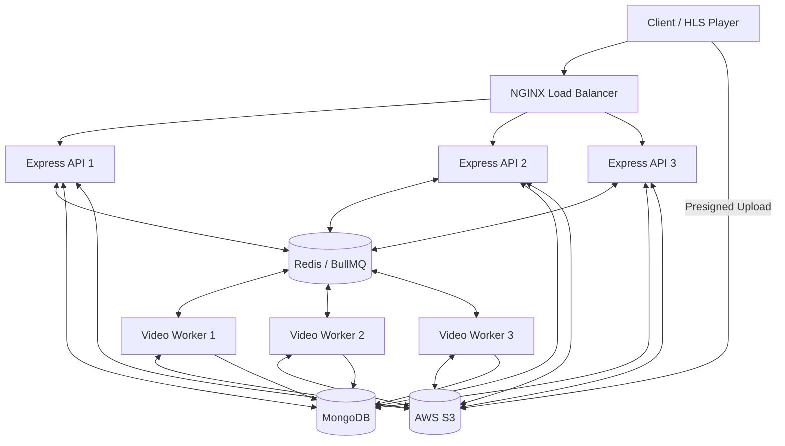
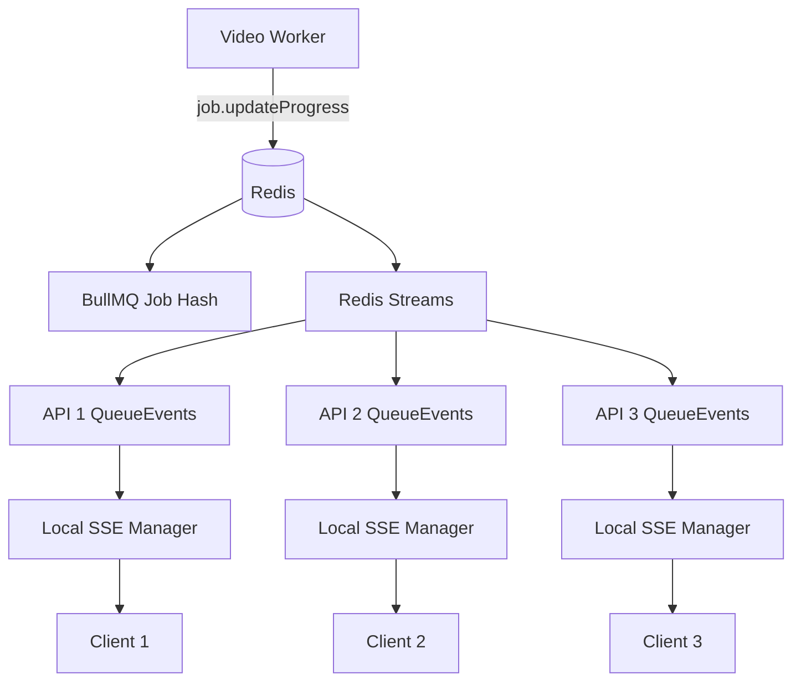

# Distributed Video Processing and Streaming Pipeline

A distributed, event-driven video processing and adaptive streaming pipeline built using Node.js, FFmpeg, BullMQ, Redis, MongoDB, AWS S3 and NGINX.

The project demonstrates asynchronous job processing, horizontal scaling, adaptive bitrate streaming, real-time progress tracking, load balancing and API-level fault tolerance.

## Features

- Direct video uploads to AWS S3 using presigned URLs.
- Asynchronous video processing using BullMQ and Redis.
- Multi-resolution video transcoding using FFmpeg.
- Automatic thumbnail generation.
- HLS segmentation and master playlist generation.
- Adaptive bitrate streaming at 360p, 480p and 720p.
- Video streaming from private S3 storage through Express.
- Real-time processing progress using Server-Sent Events (SSE).
- Distributed event delivery using BullMQ QueueEvents and Redis Streams.
- SSE heartbeat, automatic reconnection and state recovery.
- Horizontally scalable video processing workers.
- Configurable worker concurrency.
- Horizontally scalable Express API instances.
- NGINX reverse proxy and round-robin load balancing.
- Automatic SSE recovery following API server failure.
- Automated worker performance benchmarking.

## System Architecture



Each API instance maintains its own SSE connection registry and QueueEvents listener while sharing Redis, MongoDB and S3 infrastructure.

Workers operate independently and dynamically consume jobs from the shared BullMQ queue.

## Technology Stack

| Component | Technology |
|---|---|
| Backend | Node.js, Express.js |
| Database | MongoDB, Mongoose |
| Job Queue | BullMQ |
| Queue Storage | Redis |
| Event Distribution | Redis Streams, BullMQ QueueEvents |
| Video Processing | FFmpeg, FFprobe |
| Object Storage | AWS S3 |
| Streaming Protocol | HLS |
| Video Player | HLS.js |
| Real-Time Communication | Server-Sent Events |
| Load Balancer | NGINX |
| Infrastructure | Docker |
| Benchmarking | Node.js, BullMQ |

## Video Processing Workflow

1. The client requests a presigned upload URL from the API.
2. The client uploads the original video directly to AWS S3.
3. The uploaded video is registered through the API.
4. Video metadata is stored in MongoDB.
5. A processing job is added to the BullMQ queue.
6. An available worker claims the job.
7. The worker downloads the original video from S3.
8. FFmpeg generates a thumbnail.
9. The video is transcoded into 360p, 480p and 720p variants.
10. Each variant is converted into HLS segments and media playlists.
11. A master HLS playlist is generated.
12. Processed files are uploaded to S3.
13. MongoDB is updated with the completed video metadata.
14. The client receives completion through SSE and initializes the HLS player.

## Real-Time Progress Tracking

The pipeline uses an event-driven architecture instead of continuous HTTP polling.



BullMQ maintains the latest job progress in Redis and publishes job lifecycle events through Redis Streams.

Each API instance independently receives these events and broadcasts them to its locally connected SSE clients.

### Progress Milestones

| Progress | Completed Stage |
|---:|---|
| 15% | Video download |
| 25% | Thumbnail generation |
| 40% | 360p transcoding |
| 55% | 480p transcoding |
| 70% | 720p transcoding |
| 85% | HLS generation |
| 95% | S3 uploads |
| 100% | Processing completed |

Progress values represent processing milestones rather than estimated elapsed processing time.

### SSE Connection Management

- In-memory client registry using `Map<jobId, Set<Response>>`.
- One QueueEvents listener per API instance.
- Initial state snapshot when a client connects.
- Heartbeat messages every 15 seconds.
- Automatic reconnection using the browser EventSource API.
- State recovery using Redis and MongoDB.
- Connection cleanup after completion or disconnection.
- Protection against stale progress updates on the client.

## Horizontal Worker Scaling

Multiple independent worker processes consume jobs from the same BullMQ queue.

Worker concurrency can be configured using the `WORKER_CONCURRENCY` environment variable.

```bash
WORKER_CONCURRENCY=3 node src/workers/videoWorker.js
```

For example:

| Worker Processes | Concurrency per Worker | Maximum Active Jobs |
|---:|---:|---:|
| 1 | 1 | 1 |
| 2 | 1 | 2 |
| 1 | 2 | 2 |
| 3 | 3 | 9 |

FFmpeg runs as an external process, allowing multiple video processing jobs to execute concurrently.

Actual performance depends on available CPU resources, FFmpeg threading, disk I/O, memory and network bandwidth.

## Performance Benchmarking

An automated benchmarking script is available at:

```text
benchmarks/workerBenchmark.js
```

The benchmark:

- Generates concurrent video registration requests.
- Tracks job completion using BullMQ QueueEvents.
- Retrieves execution timestamps from Redis.
- Calculates queue waiting time, processing time and total latency.
- Measures batch completion time and overall throughput.

### Running the Benchmark

```bash
BENCHMARK_S3_KEY="videos/YOUR_VIDEO.mp4" \
TOTAL_JOBS=12 \
node benchmarks/workerBenchmark.js
```

### Experimental Results

The following results were obtained during local testing using the same source video.

| Workers | Concurrency | Jobs | Batch Time | Avg. Processing | Avg. Latency | Throughput |
|---:|---:|---:|---:|---:|---:|---:|
| 1 | 1 | 3 | 89.73s | 29.90s | 61.01s | 2.01/min |
| 2 | 1 | 3 | 64.67s | 35.10s | 45.85s | 2.78/min |
| 1 | 2 | 3 | 68.51s | 37.03s | 50.67s | 2.63/min |
| 3 | 3 | 12 | 139.41s | 88.50s | 109.07s | 5.16/min |

### Observations

- Increasing worker capacity improved overall video processing throughput.
- Two independent workers reduced the three-job batch completion time by approximately 28%.
- Three workers with concurrency three achieved a throughput of 5.16 videos per minute.
- Higher concurrency increased individual processing times, consistent with shared resource contention.
- BullMQ dynamically assigned waiting jobs as processing slots became available.
- All 12 jobs completed successfully during the high-concurrency experiment.

These are preliminary single-machine benchmark results. The high-concurrency experiment used a different batch size, so its throughput is not a strictly controlled speedup comparison.

## API Horizontal Scaling

Multiple Express API instances can run independently on different ports.

```bash
PORT=5200 node src/server.js
```

```bash
PORT=5201 node src/server.js
```

```bash
PORT=5202 node src/server.js
```

Each instance has:

- An independent Node.js process and event loop.
- Its own MongoDB and Redis connections.
- A dedicated QueueEvents listener.
- A local SSE connection registry.
- A unique server identifier exposed through the `X-Server-Id` response header.

All instances share the same persistent video metadata, job state and object storage.

## NGINX Load Balancing

NGINX provides a unified entry point for all API instances.

```text
Client
  |
NGINX :8080
  |
  +-- Express :5200
  +-- Express :5201
  +-- Express :5202
```

The NGINX configuration is available at:

```text
nginx/nginx.conf
```

Features include:

- Round-robin request distribution.
- Reverse proxying.
- Support for long-lived SSE connections.
- Disabled proxy buffering for immediate event delivery.
- Forwarding of HTTP request headers.
- Passive upstream failure handling.

Video registration, SSE connections and individual HLS segment requests can be handled by different API instances.

Sticky sessions are not required for the current architecture.

### Start NGINX

For Windows with Docker Desktop and Git Bash:

```bash
MSYS_NO_PATHCONV=1 docker run -d \
  --name video-nginx \
  -p 8080:80 \
  -v "$(pwd)/nginx/nginx.conf:/etc/nginx/nginx.conf:ro" \
  nginx:alpine
```

### Verify Load Balancing

```bash
for i in {1..9}; do
    curl -sS -I http://localhost:8080/player.html \
    | grep -i "X-Server-Id"
done
```

The response headers identify the API instance handling each request.

## Fault Tolerance

API-level fault recovery has been tested by terminating an API process while a browser maintained an active SSE connection.

The recovery workflow is:

1. The API process handling the SSE connection terminates.
2. The browser detects the connection loss.
3. EventSource automatically initiates a reconnection.
4. NGINX routes the new connection to an available API instance.
5. The new API retrieves the latest video and job state from MongoDB and Redis.
6. An initial snapshot restores the client's progress.
7. Subsequent progress events are delivered through the new SSE connection.
8. The independent video worker continues processing without interruption.

The experiment verified automatic reconnection, progress recovery, uninterrupted worker execution and successful video playback without manually refreshing the browser.

This currently provides API-process-level fault recovery. Redis, MongoDB and NGINX remain single points of failure.

## API Endpoints

| Method | Endpoint | Description |
|---|---|---|
| POST | `/api/video/upload-url` | Generate a presigned S3 upload URL |
| POST | `/api/video/register` | Register an uploaded video and enqueue processing |
| GET | `/api/video/:videoId/status` | Retrieve video status and processing progress |
| GET | `/api/video/:videoId/progress` | Subscribe to real-time SSE progress |
| GET | `/api/stream/:videoId/master.m3u8` | Retrieve the master HLS playlist |
| GET | `/api/stream/:videoId/:quality/index.m3u8` | Retrieve a quality-specific playlist |
| GET | `/api/stream/:videoId/:quality/:segment` | Stream an HLS video segment |

## S3 Storage Structure

```text
videos/
    original-video.mp4

processed/
    videoId/
        master.m3u8
        thumbnail.png
        360p/
            index.m3u8
            index0.ts
            index1.ts
        480p/
            index.m3u8
            index0.ts
            index1.ts
        720p/
            index.m3u8
            index0.ts
            index1.ts
```

The S3 bucket remains private. HLS playlists and segments are retrieved through the Express streaming endpoints.

## Project Structure

```text
video-pipeline/
├── benchmarks/
│   └── workerBenchmark.js
├── nginx/
│   └── nginx.conf
├── public/
│   └── player.html
├── src/
│   ├── config/
│   ├── controllers/
│   ├── events/
│   │   ├── sseManager.js
│   │   └── videoQueueEvents.js
│   ├── models/
│   ├── queues/
│   ├── routes/
│   ├── utils/
│   ├── workers/
│   │   └── videoWorker.js
│   └── server.js
├── temp/
├── .gitignore
├── package.json
└── README.md
```

## Local Setup

### Prerequisites

- Node.js
- Docker
- FFmpeg and FFprobe
- AWS account and S3 bucket
- Git

### Clone the Repository

```bash
git clone https://github.com/Peyushxcode/video-processing-pipeline.git
cd video-processing-pipeline
npm install
```

### Start Redis and MongoDB

```bash
docker run -d --name video-redis -p 6379:6379 redis:7
```

```bash
docker run -d --name video-mongo -p 27017:27017 mongo:7
```

If these services already exist, start the existing containers instead.

### Environment Configuration

Create a `.env` file containing the required configuration for:

- MongoDB connection URI.
- Redis connection.
- AWS region and S3 bucket.
- AWS credentials or an appropriate AWS credential provider.
- FFmpeg and FFprobe executable paths, if required.
- API port.
- Worker concurrency.

Never commit AWS credentials or the `.env` file to version control.

### Start the API Server

```bash
node src/server.js
```

### Start the Video Worker

```bash
WORKER_CONCURRENCY=1 node src/workers/videoWorker.js
```

Additional worker instances can be started independently.

### Register an Uploaded Video

```bash
curl -X POST http://localhost:8080/api/video/register \
-H "Content-Type: application/json" \
-d '{"s3Key":"videos/YOUR_VIDEO.mp4"}'
```

Use port 5200 instead of 8080 when running without NGINX.

### Open the Video Player

```text
http://localhost:8080/player.html?videoId=YOUR_VIDEO_ID
```

The player displays real-time processing progress and initializes adaptive HLS playback once processing completes.

## Future Improvements

- Dockerization of API and worker services.
- Docker Compose orchestration and service scaling.
- CDN integration using AWS CloudFront.
- Distributed load testing across multiple machines.
- FFmpeg thread optimization and resource-aware concurrency.
- Worker failure recovery and retry policies.
- Idempotent job processing.
- Automatic temporary file cleanup.
- HLS segment and keyframe alignment.
- Authentication and authorization for video access.
- Centralized monitoring and observability.
- Kubernetes deployment and autoscaling.
- Redis Pub/Sub implementation and comparison with Redis Streams.

## Project Objective

This project explores the practical implementation of distributed backend systems through a video processing and streaming use case, focusing on asynchronous processing, event-driven communication, horizontal scalability, performance measurement and fault recovery.
